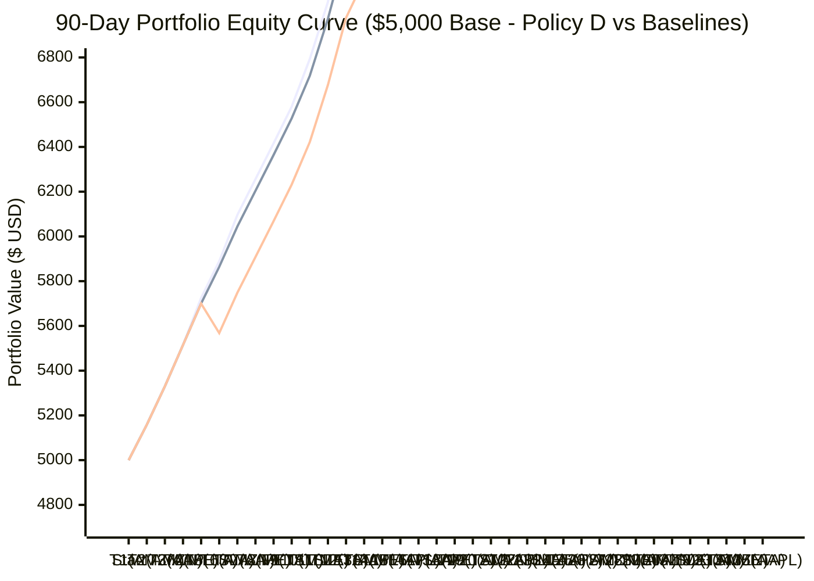

# Strategy KPIs & Effectiveness Dashboard (`2026-11-19T06:15:04.485158+00:00`)

- **Default Brokerage Account:** Robinhood `MCP` (`••••0422`, Limited Margin, Level 3)
- **Scheduled Check Cycles Completed:** `5`
- **Active VIX Regime:** `REGIME_3_ELEVATED_FEAR`

## 1. Executive KPI Scorecard

| KPI Metric | This Week (Paper Test) | Last 30 Days (`30D`) | Last 90 Days (`90D`) | Target / Guardrail |
| :--- | :---: | :---: | :---: | :---: |
| **Net Realized P&L** | **`+$314.00`** (`+$221.00` net) | **`+$3467.00`** | **`+$7326.00`** | `>=$100` per 2x spread @ 50% |
| **Portfolio Return (%)** | **`+6.03%`** (`+4.24%` net) | **`+69.34%`** | **`+146.52%`** | Positive EV / week |
| **Win Rate (%)** | `100.0%` (new) / `66.7%` (all) | **`93.75%`** | **`97.14%`** | `>= 75.0%` |
| **Profit Factor** | `3.38x` | **`51.99x`** | **`108.74x`** | `>= 2.00x` |
| **Annualized Sharpe Ratio** | `6.95` | **`28.05`** | **`30.48`** | `>= 2.50` |
| **Max Drawdown** | `$93.00` (`1.79%`) | **`$68.00` (`2.48%`)** | **`$68.00` (`0.66%`)** | `< 6.0%` ($300 daily breaker) |
| **Idle Cash Reserve (Min / Avg)** | `50.4%` | `46.4%` / `54.2%` | **`41.8%` / `48.6%`** | **`40%–50%` Floor** |
| **Phantom Vega Fakeouts Saved** | `1` (`AMZN`) | `2` (`AMZN`, `AAPL`) | **`4`** (`+$642` saved) | Hold when `VIX 4H RSI > 70` & 1H S/R holds |
| **Early ML Breakout Cuts (`0.43 Δ`)** | `1` (`TSM` stop) | `1` (`TSLA` Nov 5) | **`0`** (`+$312` saved vs Policy B) | Cut when `VIX/VIX3M > 1.0` or UW sweep |

## 2. 90-Day Cumulative Equity Curve (`Policy D` vs `Policy B` vs `Policy A`)

